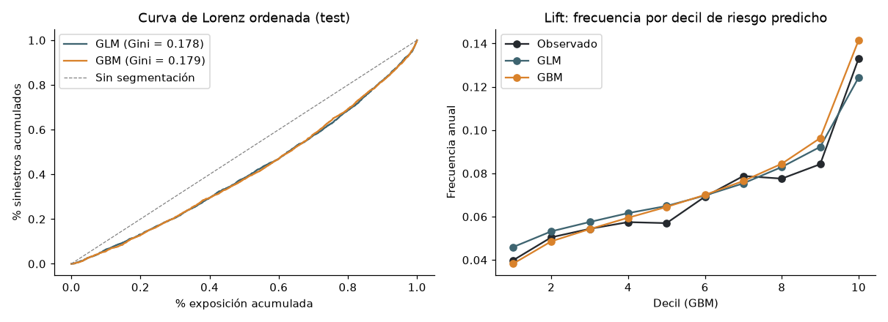
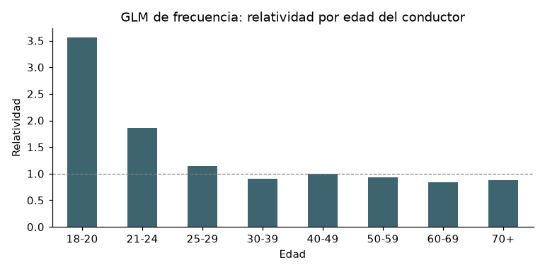

# Tarificación de RC de automóviles: GLM frente a gradient boosting

> **EN:** Motor third-party liability pricing on 413,169 real policies: SQL exploration, Poisson GLM vs Poisson
> gradient boosting for claim frequency, Gamma GLM for severity with large-loss loading, and model comparison
> with deviance, Gini and lift charts.

Prima pura de una cartera real de automóviles con el enfoque actuarial clásico (**GLM de frecuencia × GLM de severidad**),
comparado con un modelo de *machine learning* (**gradient boosting con pérdida de Poisson**).



## Resultados clave

**Frecuencia en la muestra de test** (82.634 pólizas, 20 % de la cartera)

| Modelo | Devianza de Poisson media | Gini |
|---|---:|---:|
| Frecuencia media (sin segmentar) | 0,4434 | 0,006 |
| GLM de Poisson (41 parámetros) | 0,4351 | 0,178 |
| Gradient boosting de Poisson | 0,4350 | 0,179 |

- **El GLM y el gradient boosting rinden casi igual.** Con pocas variables y bien tratadas (tramos de edad,
  logaritmo de la densidad), el GLM recoge casi toda la señal y además es **interpretable y fácil de implantar**
  en un sistema de tarificación. El gradient boosting es útil como contraste y para buscar interacciones.
- La **edad del conductor** es el factor más fuerte: de 18 a 20 años, la frecuencia es 3,6 veces la del tramo de referencia (40-49 años).
- Los **grandes siniestros** (por encima del percentil 99, 16.109 €) son el 1 % de los siniestros y el **29 % del coste**.
  Se separan de la severidad y se cargan aparte (622 € por siniestro).



**Ejemplos de prima pura anual**

| Perfil | Frecuencia (GLM) | Coste medio | Prima pura (GLM) |
|---|---:|---:|---:|
| Joven urbano (19 años, París) | 0,380 | 2.731 € | 1.038 € |
| Adulto medio (45 años) | 0,080 | 2.127 € | 169 € |
| Mayor rural (72 años) | 0,042 | 2.077 € | 88 € |

## Metodología

1. **SQL.** La cartera se carga en SQLite y se explora con consultas SQL: agregaciones, `CASE WHEN`, CTE y `JOIN`
   entre pólizas y siniestros.
2. **Variables.** Tramos de edad del conductor y de antigüedad del vehículo, logaritmo de la densidad y variables
   categóricas con el nivel de **mayor exposición como referencia**.
3. **Frecuencia.**
   - GLM de Poisson con *offset* `log(exposición)` (statsmodels).
   - `HistGradientBoostingRegressor` con pérdida de Poisson, objetivo `siniestros / exposición` y peso igual a la
     exposición, con *early stopping* (scikit-learn).
4. **Comparación fuera de muestra.** Devianza de Poisson, **curva de Lorenz ordenada y Gini**, y **gráfico de lift** por deciles.
5. **Severidad.** GLM Gamma con enlace logarítmico sobre los siniestros limitados al percentil 99, más un recargo
   uniforme por el exceso de los grandes siniestros.
6. **Prima pura** = frecuencia × severidad, con su calibración frente al coste observado en test (ratio de 1,06:
   la muestra de test tiene, por azar, algo menos de frecuencia que la de entrenamiento).

## Estructura

```
├── data/freMTPLfreq.csv.gz        413.169 pólizas (exposición, nº de siniestros y factores de riesgo)
├── data/freMTPLsev.csv.gz         16.181 importes de siniestros
├── notebooks/motor_pricing.ipynb  análisis completo con gráficos
└── figures/                       gráficos del análisis
```

## Cómo ejecutarlo

```bash
pip install -r requirements.txt
jupyter notebook notebooks/motor_pricing.ipynb
```

## Posibles mejoras

- Interacciones en el GLM detectadas con el gradient boosting (por ejemplo, edad × potencia) e interpretación con SHAP.
- Validación cruzada de los hiperparámetros del gradient boosting.
- Modelo Tweedie directo para la prima pura y comparación con frecuencia × severidad.

## Fuente de los datos

`freMTPLfreq` y `freMTPLsev` del paquete de R *CASdatasets* (A. Charpentier, licencia GPL-2), en
*Computational Actuarial Science with R* (Charpentier, 2014).

## Autora

**Tingting Wu**, Máster en Ciencias Actuariales y Financieras (Universitat de València) ·
[LinkedIn](https://www.linkedin.com/in/tingting-wu-8b9320243)
